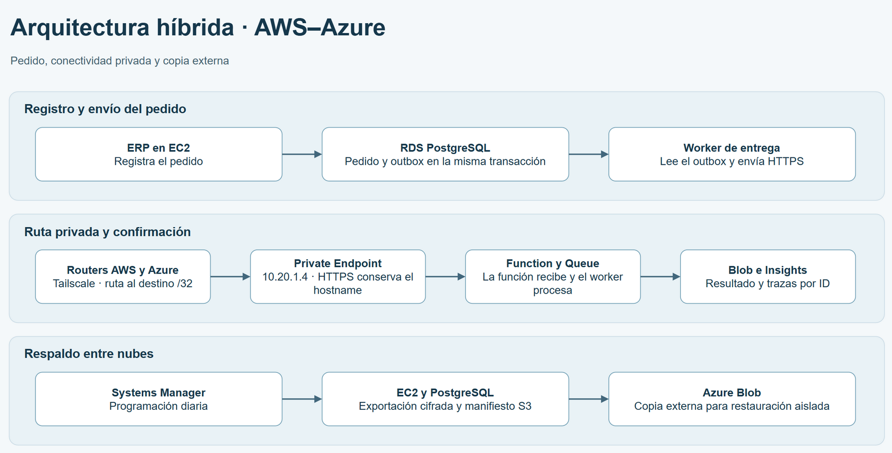

# Tangamandapio · ERP B2B en AWS y Azure

Proyecto de portafolio de **José Dario Zúñiga Medina**. El ERP de pedidos se ejecuta en AWS y se integra con un WMS privado en Azure. El proyecto incluye el código de la aplicación, infraestructura como código y pruebas de permisos, escalado y recuperación.

[Portal de demostración](https://tangamandapio.kendellnm.me/) · [Arquitectura](Proyecto_Cloud_Tangamandapio/02_Arquitectura/README.md) · [Pruebas y evidencias](Proyecto_Cloud_Tangamandapio/06_Pruebas/README.md) · [Entrega académica](Proyecto_Cloud_Tangamandapio/README.md)

## Qué demuestra el proyecto

- **ERP con permisos por rol y empresa.** Pedidos, inventario, compras, finanzas y auditoría, con validación de acceso en el servidor. Incluye correo interno y telefonía WebRTC. [Registro de las pruebas de navegador](Proyecto_Cloud_Tangamandapio/06_Pruebas/Verificacion_ERP_2026-11-22.json).
- **Integración privada AWS–Azure.** Un pedido y su evento se guardan en PostgreSQL. El outbox entrega el evento a Azure Functions por Tailscale y Private Endpoint. El procesamiento se rastrea en Queue, Blob y Application Insights. [Topología y rutas](Proyecto_Cloud_Tangamandapio/03_Redes/README.md).
- **Disponibilidad y seguridad.** ALB, Auto Scaling en dos zonas, RDS Multi-AZ, AWS WAF con registros y alertas en ambas nubes. [Seguridad](Proyecto_Cloud_Tangamandapio/05_Seguridad/README.md) · [Monitoreo](Proyecto_Cloud_Tangamandapio/07_Monitoreo/README.md).
- **Respaldo entre nubes.** Copia diaria cifrada de PostgreSQL a Azure Blob, con restauración probada y consulta de las copias desde Administración. [Procedimiento y mediciones de recuperación](Proyecto_Cloud_Tangamandapio/08_Backup_DR/README.md).

## Resultados medidos

| Ensayo | Resultado |
| --- | --- |
| ERP por roles | 309 comprobaciones en 10 sesiones de producción. Las escrituras de prueba se ejecutaron por separado en un entorno aislado. |
| Autoescalado por carga | 2 → 3 → 2 instancias en el ensayo del 22/11. El grupo admite de 2 a 5. |
| Conmutación de la ruta privada | Primer HTTPS 200 al WMS en 2,64 s y 2,60 s desde las dos EC2 del ensayo. |
| Restauración aislada | 20 tablas en 35,108 s. Otro ensayo levantó el ERP y verificó dos pedidos recuperados. |

Las mediciones aplican a los escenarios de cada [registro de prueba](Proyecto_Cloud_Tangamandapio/06_Pruebas/README.md). La recuperación en una segunda región queda como ampliación.

## Código y reproducción

| Ruta | Contenido |
| --- | --- |
| [`app/`](app/README.md) | ERP, interfaz web y Azure Function. |
| [`iac/`](iac/README.md) | Orden de aprovisionamiento y separación de estados. [CloudFormation para AWS](Proyecto_Cloud_Tangamandapio/04_IaC/cloudformation/README.md) · [Terraform para Azure](Proyecto_Cloud_Tangamandapio/04_IaC/terraform/README.md). |
| [`tests/`](tests/README.md#puerta-local-sin-costo-cloud) | Pruebas locales y procedimientos de validación. |
| [`Proyecto_Cloud_Tangamandapio/`](Proyecto_Cloud_Tangamandapio/README.md) | Diagramas editables, direccionamiento, evidencia y [cortes de costos](Proyecto_Cloud_Tangamandapio/09_Costos/README.md). |

La demo utiliza datos sintéticos. El portal requiere una cuenta autorizada para consultar los módulos internos.
