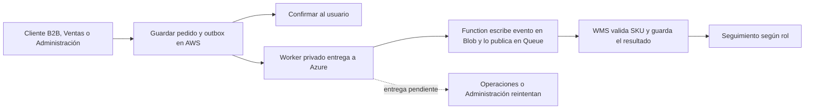

# Centro de nube, seguridad y usuarios

El [mapa de estado actual](../../evidence/current/MAPA_ESTADO_ACTUAL_2026-10-08.md)
es la fuente para saber qué quedó activo en AWS. Esta guía describe el módulo y
su preparación; no equivale a una validación autenticada de navegador.

El módulo local está en `/platform`. Lo pueden abrir Administración y
Operaciones TI. El backend vuelve a comprobar el rol; ocultar el acceso del
menú no es la barrera de seguridad.

Incluye:

- solicitudes, latencia p95, errores 5xx y destinos saludables del ALB;
- CPU y conexiones de RDS;
- bloqueos WAF y capacidad del Auto Scaling Group cuando esos recursos publican
  métricas configuradas;
- estado de controles del portal y contadores del proceso web actual;
- trazabilidad de la cola transaccional: consulta bajo demanda del estado final
  de cada evento en Azure y reintento auditado para Operaciones/Administración;
- edición de rol, empresa y estado de cuentas; restablecimiento de contraseña
  con revelado único. El API invalida las sesiones y audita los cambios.

El estado de Azure se consulta por evento y no modifica inventario desde esta
pantalla. Si el endpoint de cumplimiento está en modo `demo-only`, se marca
visiblemente como demostración. Los reintentos requieren confirmación y solo
Operaciones TI o Administración pueden ejecutarlos.

## Seguimiento de pedidos por rol

Desde **Seguimiento de pedidos**, selecciona un pedido o abre `/seguimiento?pedido=<id>`.
El orden de trabajo es **registro en el portal → entrega al almacén → resultado**.
En producción, el portal registra las líneas y el outbox en una transacción y
responde al comprador antes de esperar a Azure. El worker usa el mismo ID de
evento en cada intento. **Verificar en almacén** consulta el resultado de Azure
bajo demanda. Los pedidos antiguos sin líneas pueden requerir revisión y el
resultado del inventario de laboratorio se etiqueta como demostración.



| Rol existente | Acciones en seguimiento |
| --- | --- |
| Cliente B2B | Registra pedidos con SKU y cantidad y consulta los de su empresa. |
| Ventas | Registra pedidos y revisa los resultados operativos permitidos por su rol. |
| Almacén | Consulta las líneas y el resultado técnico del WMS. |
| Operaciones TI | Supervisa el outbox y las colas de Azure y reintenta entregas con auditoría. |
| Auditoría | Consulta el historial técnico y las marcas de tiempo. |
| Administración | Registra, consulta, reintenta y asigna roles desde el formulario existente. |

La consulta de colas diferencia un conteo de cero de una lectura no disponible.
En Azure se reutilizan Function Flex, identidad administrada, Storage Queue,
Blob y Application Insights. Las operaciones de consulta leen metadatos y dejan
los mensajes en sus colas. El flujo B2B identifica sus propios eventos aunque
un pedido de ERP tenga el mismo número.

Del ejemplo ANDESLOG se reutilizan la ruta privada, el outbox PostgreSQL, la
idempotencia por evento y la trazabilidad en Application Insights. El despliegue
propio usa un NAT Gateway zonal compartido en AWS y carece de un recurso NAT
Gateway en Azure. Los dos NAT por zona, Traffic Manager, Azure Files para SMB y
la réplica regional del diagrama son opciones para requisitos y presupuestos
distintos.

## Respaldos y pruebas de capacidad

Entra a `/administracion` con una cuenta administradora. **Respaldos** muestra
las copias de Azure Blob y de S3 por separado, con fecha, tamaño, descarga y
distintivo para la última de cada almacén. La descarga pasa por el portal con
sesión activa y se registra en la auditoría.

- **Ejecutar respaldo** toma una lectura consistente de pedidos, sus líneas
  (`items_json`) y todos los estados del outbox. Guarda un JSON con SHA-256 en el
  prefijo privado `dr/postgres/manual-outbox/` de S3 con cifrado SSE-S3 y retención
  de 30 días. El botón funciona sin Azure y no reenvía ni cambia eventos. El
  límite por copia es de 5.000 filas por tabla y 16 MiB. Este archivo sirve para
  conservar y analizar el registro operativo. Para recuperar toda la base se
  usa el respaldo programado de PostgreSQL y el procedimiento de restauración.
- **Azure Blob** muestra las copias del contenedor privado
  `tangama-postgres-backups`. La descarga conserva su cifrado original. El portal
  lee la autorización HTTPS de solo lectura y listado desde el `SecureString`
  `/<proyecto>/dr/blob-read/portal`. La autorización actual vence el 12 de
  diciembre de 2026. Renueva ese parámetro antes de su vencimiento. La
  autorización de escritura del respaldo diario se renueva por separado.
- **Prueba de escalado** permite pedir 3, 4 o 5 instancias y seguir la capacidad
  sana del ASG. El sistema programa primero el regreso a la capacidad anterior
  y luego sube el mínimo y el objetivo durante unos diez minutos. Completa una
  prueba antes de iniciar otra. Un ajuste manual de capacidad resulta visible
  en el panel. El comportamiento de la política bajo tráfico se mide con k6.

CloudFormation administra los permisos del rol de instancia limitados al ASG
del proyecto, al prefijo de respaldos y al parámetro de lectura. El listado de
grupos y acciones programadas usa los permisos de consulta que admite AWS para
esas APIs. La plantilla configura el almacenamiento de Azure mediante
`AdminAzureBackupAccount` y `AdminAzureBackupContainer`. Si el primero está vacío,
el resto del módulo sigue disponible.

Para repetir el tramo sostenido, configura `PORTAL_BASE_URL` con el HTTPS del
portal, `PORTAL_HOST` con ese mismo dominio y `ORIGIN_IP` con una IP actual del
ALB. `tests/performance/aws_autoscaling_alb_requests.js` verifica HTTPS con el
nombre del portal. En el ensayo acotado se usó `TARGET_PATH=/ready`,
`TARGET_VUS=25`, `RAMP_UNIT=10s`, `HOLD_DURATION=120s` y
`RAMP_DOWN_DURATION=10s`. `SUMMARY_EXPORT_PATH` guarda las latencias y los tres
contadores de errores. La prueba de capacidad manual y esta carga miden
cosas diferentes. Ejecuta una cada vez para poder atribuir el cambio al
mecanismo que estás comprobando.

## Qué enseña sobre la nube y qué queda por activar

- **Balanceo y escalabilidad:** el ALB recibe tráfico y distribuye solicitudes
  entre sus destinos sanos. La consola presenta solicitudes, latencia p95,
  errores y salud del target group. Para demostrar elasticidad automática hace
  falta verificar o asociar un Auto Scaling Group real; no se afirma que exista
  solo porque el ALB tenga más de una instancia.
- **Base de datos:** PostgreSQL/RDS conserva los pedidos; la consola presenta
  CPU y conexiones cuando se configura su identificador. Multi-AZ y backups
  son propiedades de RDS, no una métrica inferida del panel.
- **Seguridad:** WAF protege el borde; la aplicación valida sesión, rol y CSRF;
  las credenciales de servicios deben venir del rol de instancia o de un
  almacén de secretos, nunca del navegador. La consola muestra controles de la
  aplicación y contadores WAF si están habilitados.
- **Integración multicloud:** AWS mantiene pedido y outbox durable; Azure recibe
  el evento por Function/Queue y guarda evidencia. El consumidor actual es una
  simulación didáctica, no un WMS con inventario real.

Para analizar experiencia dentro del navegador, el siguiente complemento es
CloudWatch RUM y Synthetics (mediciones reales y recorridos automatizados). Para
investigar solicitudes concretas, se pueden habilitar access logs del ALB a S3
y consultar agregados con Athena. Ninguno está habilitado por esta página. Para
ampliar la demostración de seguridad, CloudTrail registra actividad de cuenta;
GuardDuty y AWS Config son complementos sujetos a costo/cuota del laboratorio.

## Activar métricas reales de CloudWatch

La página no inventa valores: si no encuentra identificadores o permisos,
explica qué falta. El backend consulta exclusivamente `GetMetricData`, mediante
el rol de instancia de AWS, sin claves persistentes. La política mínima de
lectura está en `iac/modules/cloudwatch-platform-console-policy.json`.

Configura en el entorno del servicio los recursos que existan realmente:

```text
CLOUDWATCH_REGION_NAME=us-east-1
CLOUDWATCH_LOAD_BALANCER_FULL_NAME=app/<nombre>/<id>
CLOUDWATCH_TARGET_GROUP_FULL_NAME=targetgroup/<nombre>/<id>
CLOUDWATCH_RDS_INSTANCE_ID=<identificador-rds>
CLOUDWATCH_AUTO_SCALING_GROUP=<nombre-asg-si-existe>
CLOUDWATCH_WAF_WEB_ACL_NAME=<nombre-acl-si-publica-metricas>
CLOUDWATCH_WAF_REGION=us-east-1
```

El ALB y Target Group deben configurarse juntos. RDS, ASG y WAF son
independientes. `CLOUDWATCH_AUTO_SCALING_GROUP` es opcional a propósito: el
portal no declara que haya autoescalado hasta comprobar que existe y reporta
capacidad. El rol de instancia solo necesita `cloudwatch:GetMetricData`; no se
habilitan operaciones de creación, borrado ni modificación de infraestructura.

## Límite del despliegue

La política de solo lectura está preparada en código, pero no se debe afirmar
que el panel recibe métricas reales hasta comprobar permisos y configuración en
el servicio desplegado. La plantilla CloudFormation actual coincide con la del
stack según el [mapa vigente](../../evidence/current/MAPA_ESTADO_ACTUAL_2026-10-08.md);
antes de cualquier cambio, generar y revisar el change set. No aplicar Terraform
Azure: su state local apunta a un grupo anterior.

La serie de ALB representa tráfico agregado de la aplicación. Los contadores
de Flask son propios del proceso que atendió la vista, no una suma confiable de
todos los workers. Para monitoreo web agregado se usa ALB/CloudWatch; para
solicitudes individuales se conservan logs estructurados con ID de solicitud.
