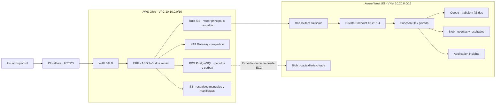

# Infraestructura como código

## Estado y recuperación vigentes

Consulta el [índice de entrega](../Proyecto_Cloud_Tangamandapio/README.md) y las [guías de operación](../Proyecto_Cloud_Tangamandapio/04_IaC/README.md). CloudFormation
administra los logs del ALB mediante `EnableAlbAccessLogs` y la retención del
prefijo `alb-access/`. El [presupuesto ARM](azure-monitoring/subscription-budget.json)
se despliega a nivel de suscripción, fuera de las raíces Terraform existentes.

La [pila de logging del WAF](cloudformation/aws-waf-logging.yaml) asocia la ACL
regional del ALB con `aws-waf-logs-tangamandapio-alb`. Conserva siete días de
tráfico y omite los valores de cookies, cabeceras de credenciales y cadenas de
consulta. Despliégala después de asociar el WAF al ALB, usando el ARN de la ACL
del entorno correspondiente. Revisa `AWS-WAF` y `AmazonCloudWatch` en el corte
de facturación posterior a la activación.

La [pila del respaldo diario](cloudformation/aws-azure-postgres-backup.yaml)
usa Systems Manager a las 03:00 de Lima. Los manifiestos privados de S3 están
en `dr/postgres/manifests/<fecha-UTC>.json`. Contienen el nombre de la copia
y ambas huellas para restaurar. La autorización de solo creación vive en el
parámetro cifrado `/tangamandapio/dr/blob-write/scheduled-demo` y debe renovarse
al vencimiento. El [entorno Terraform](environments/aws-azure-tailscale)
puede administrar esa pila y la de los routers a través de CloudFormation.

### Topología comprobada

Los diagramas editables en Draw.io muestran la [infraestructura desplegada](architecture/tangamandapio-infraestructura.drawio) y los [flujos de pedidos, recuperación y conmutación](architecture/tangamandapio-flujos.drawio).



AWS tiene un NAT Gateway zonal compartido por ambas subredes de aplicación.
Azure opera sin NAT Gateway. Si falla el egreso compartido de AWS, la red
privada depende de que el túnel conserve conectividad. El ejemplo ANDESLOG
sirve de referencia para NAT por AZ, observabilidad y recuperación regional.
Adoptar un segundo NAT, un gateway administrado o una región secundaria requiere
presupuestar sus cargos continuos.

### Orden de reconstrucción

1. Verifica la cuenta AWS y la suscripción Azure. En un entorno aislado, asigna
   nombres globalmente únicos a Storage y a la Function. Identifica el estado
   Terraform ya existente antes de importar o planificar recursos vivos.
2. Prepara [la base Azure](environments/azure-rebuild) y
   [la red privada](environments/azure-private-network). Reutiliza las
   dependencias existentes cuando recuperes el entorno actual.
3. Aplica la raíz [Azure Flex privada](environments/azure-flex-private).
   Empaqueta el WMS y publícalo con OneDeploy. Guarda la Function key en AWS
   Secrets Manager fuera del estado Terraform.
4. Reconstruye el portal con [CloudFormation](cloudformation). Pasa el hostname
   de la Function, el nombre del secreto y, si se quiere recuperar el catálogo
   de respaldos, los nombres de Storage y del contenedor. Valida HTTPS y las
   dos instancias desde el ALB.
5. Restablece los [routers](environments/aws-azure-tailscale) y el
   [DNS privado](cloudformation/rebuild-private-wms-dns.sh) y
   verifica la ruta HTTPS desde cada EC2. Usa un solo propietario para las
   pilas auxiliares, Terraform o los lanzadores directos de CloudFormation.
6. Conecta la copia diaria y las autorizaciones de Blob. Registra un pedido
   sintético y comprueba su identificador en Queue, Blob e Insights. Restaura
   una copia en un PostgreSQL aislado antes de dar por cerrada la recuperación.

La prueba aislada disponible cubre red/S3 y una simulación de escalado.
El ciclo completo entre nubes desde cuentas vacías sigue pendiente.

### Repetir el respaldo manual de PostgreSQL

1. Verifica la sesión AWS de la cuenta y el inicio Azure de la suscripción del
   proyecto. El operador necesita escribir exclusivamente en el contenedor de
   respaldo y el permiso de generar delegación de almacenamiento. El restore
   requiere leer ese contenedor y ejecutar `unwrapKey` en la clave versionada.
2. Ejecuta `python iac/scripts/run_postgres_blob_export.py --instance <EC2-app-SSM>`
   con el perfil AWS `main`. Requiere `botocore` y Azure CLI en el equipo. La
   instancia necesita el cliente PostgreSQL 18, `cryptography`, acceso TLS a
   RDS y salida HTTPS hacia Blob. La copia queda bajo `postgres/` con la regla
   de retención existente. Guarda el nombre del objeto y sus dos hashes.
3. Ejecuta `python iac/scripts/restore_postgres_blob.py --restore-host <otra-EC2-SSM> --storage sttangama261030r --container tangama-postgres-backups --object <blob> --key-id <URI-versionada> --cipher-sha256 <hash-cifrado> --archive-sha256 <hash-dump>`.
   El procedimiento usa un clúster efímero en RAM con socket local. Verifica
   los conteos y el tiempo de recuperación que imprime la orden. No se pasa
   una contraseña o URL SAS como argumento.

La identidad de este flujo manual caduca con la sesión del operador. La copia
diaria de producción ya se ejecuta con el stack `tangamandapio-azure-postgres-backup`.

### Ensayar la recuperación de todo el ERP

Desde la raíz del repositorio, usa el entorno Python de la aplicación con
`app/requirements-ci.lock`, Azure CLI con permiso de lectura del contenedor y
`unwrapKey` junto con las herramientas locales de PostgreSQL. Para un ensayo
representativo de RDS 18.3, usa binarios de PostgreSQL 18.

```powershell
python iac/scripts/rehearse_erp_recovery_from_blob.py --manifest evidence/current/azure/AZURE-ERP-RECOVERY-2026-11-20.json --postgres-bin "C:/Program Files/PostgreSQL/18/bin"
```

Agrega `--restricted-runtime` para arrancar el ERP como usuario SQL de
ejecución, comprobar que PostgreSQL deniega operaciones administrativas y
probar `pg_dump` con el lector dedicado. [Procedimiento de roles de producción](cloudformation/README.md#separar-los-permisos-de-postgresql).

Para otra fecha, usa como `--manifest` el JSON exportado de
`dr/postgres/manifests/YYYYMMDD.json` del bucket de respaldo de AWS y conserva
una copia confiable fuera de AWS antes de simular la pérdida de la región. El
script comprueba ambas huellas, restaura la base en `127.0.0.1`, levanta el ERP,
crea usuarios de ensayo en la base aislada, comprueba pedidos, permisos y correo
interno, y elimina el clúster local al finalizar. Las integraciones de envío
externo quedan desactivadas en el ensayo. [Registro de recuperación del 20/11](../evidence/current/azure/AZURE-ERP-RECOVERY-2026-11-20.json).

## Mapa de IaC

### AWS — CloudFormation

- [`cloudformation/aws-lab.yaml`](cloudformation/aws-lab.yaml): stack principal del portal, red, aplicación, ALB, Auto Scaling, RDS, seguridad, observabilidad y salidas operativas.
- [`cloudformation/deploy.sh`](cloudformation/deploy.sh): prepara y revisa un change set; aplicar requiere confirmaciones explícitas.
- [`cloudformation/rebuild.sh`](cloudformation/rebuild.sh): reconstrucción con nombre de stack explícito y modo bootstrap para no arrancar EC2 antes de publicar el artefacto.
- [`cloudformation/destroy.sh`](cloudformation/destroy.sh): eliminación protegida; purga snapshots/backups y conserva Secrets Manager/SSM por defecto; eliminar credenciales requiere una confirmación separada.
- [`cloudformation/lifecycle.sh`](cloudformation/lifecycle.sh): entrada guiada `up`/`down`; comprueba la cuenta AWS esperada y pide confirmación escrita. Su aviso declara que opera solo AWS en la región indicada; no despliega VPN, recuperación regional ni Azure, y tampoco finaliza AWS Academy.
- [`cloudformation/voice-recordings.yaml`](cloudformation/voice-recordings.yaml): recursos separados para grabaciones consentidas.
- `aws-azure-vpn.yaml`: diseño de Site-to-Site administrada. AWS Academy denegó `ec2:CreateCustomerGateway`; la plantilla no demuestra un túnel desplegado.
- `aws-azure-p2s-router.yaml`: router EC2 para la alternativa P2S. La creación de la instancia no configura por sí sola las credenciales OpenVPN ni demuestra el túnel; el material privado se mantiene fuera de Git.

### Azure y Terraform

Cada directorio de `environments/` es una raíz Terraform independiente. No se deben combinar estados ni ejecutar `apply` desde un directorio sin identificar su propósito.

| Raíz | Propósito |
|---|---|
| `azure-rebuild/` | Reconstrucción del backend WMS y sus servicios de soporte; [`lifecycle.ps1`](environments/azure-rebuild/lifecycle.ps1) guía `up`/`down` y conserva el backend remoto de Terraform. |
| `azure-private-network/` | VNet, subredes y Key Vault de red en Azure. Usa un estado remoto independiente. La raíz deja el aprovisionamiento de gateways a otras configuraciones. |
| `azure-flex-private/` | Plan Flex, Private Endpoint y resolución DNS privada. |
| `azure-p2s-vpn/` | VPN Gateway P2S y configuración de acceso para el piloto privado. |
| `azure-tfstate/` | Almacenamiento remoto del estado Terraform. |
| `aws-azure-tailscale/` | IaC de la conectividad Tailscale y de dependencias que deben reconciliarse con su propietario actual. |
| `aws-azure-vpn/` | Diseño alternativo de VPN administrada entre nubes. |
| `azure-demo/`, `demo/` | Entornos demostrativos separados; no aplicar sobre los recursos del portal. |

Los prototipos locales de IPsec/WireGuard no están validados de extremo a extremo y no forman parte de la IaC publicada.

Los módulos compartidos están en `modules/`; `modules/oci_network/` es material de comparación y no significa que OCI esté desplegado.

## ¿Se puede reconstruir tras reiniciar la cuenta?

La infraestructura está descrita parcialmente en CloudFormation y Terraform, pero **no se ha probado una reconstrucción integral desde una cuenta vacía**. Para recuperarla hacen falta, además del código:

1. Un inventario vivo, la cuenta/región correctas y permisos suficientes para leer y crear recursos.
2. El backup/snapshot de PostgreSQL que se decida conservar, credenciales nuevas y configuración segura de Secrets Manager/Key Vault.
3. Un release del portal publicado en S3 y los paquetes de Functions requeridos.
4. Credenciales de enrolamiento de Tailscale, rutas aprobadas y configuración privada de DNS. Entrega las credenciales por el almacén de secretos.
5. DNS y certificado HTTPS revalidados para el nombre disponible.
6. Planes revisados y una restauración de datos probada antes de habilitar el tráfico.

Los lanzadores de ciclo de vida validan la cuenta/suscripción y solicitan una confirmación literal; no sustituyen los permisos ni los respaldos. El lanzador de Azure solo administra la raíz `azure-rebuild`; las raíces de VPN/Flex y el backend de state se operan aparte. El lanzador AWS administra el stack principal y el stack de grabaciones, no recursos externos que no pertenezcan a esos stacks.

Un `.tfstate` no reemplaza el código ni un backup. El estado Terraform activo está en almacenamiento remoto; los estados, planes y secretos no se suben a GitHub.

## Reglas antes de cualquier cambio

- Comprueba identidad y suscripción con los mecanismos oficiales; una sesión STS válida no garantiza permiso para inventariar o desplegar.
- Lee el change set/plan completo. No ejecutes `apply`, `deploy` o `destroy` con nombre de stack supuesto.
- Conserva datos y secretos; comprueba `DeletionPolicy`, `UpdateReplacePolicy` y la retención real antes de cambios destructivos.
- WAF, RDS Multi-AZ, gateways VPN, EC2 y almacenamiento generan consumo. En AWS Academy pueden existir denegaciones SCP/IAM explícitas; no las eludas.
- No guardes credenciales de AWS/Azure, llaves VPN, PFX, state ni planes en Git o en argumentos de consola.

Guía operativa AWS: [`cloudformation/README.md`](cloudformation/README.md). Los scripts de costo y conectividad están en `scripts/`.
